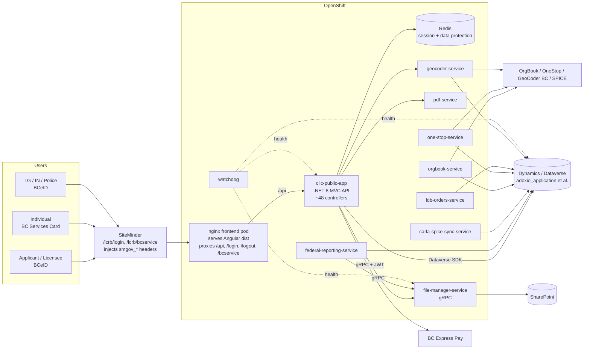
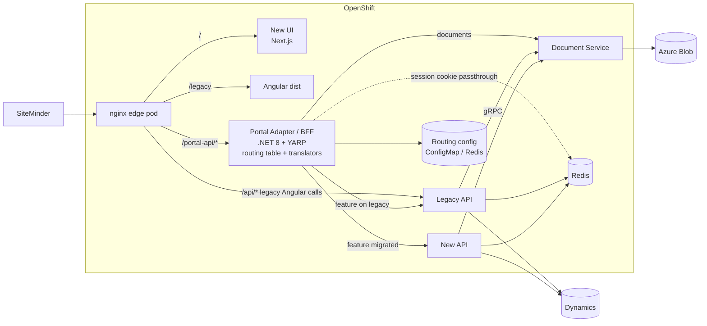
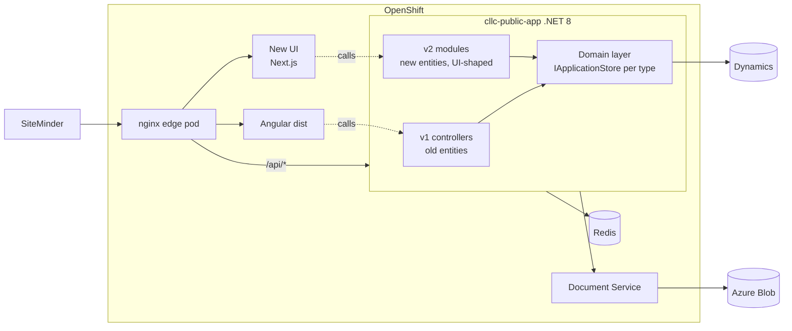
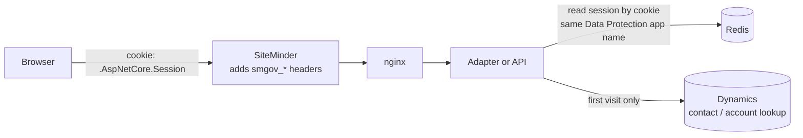
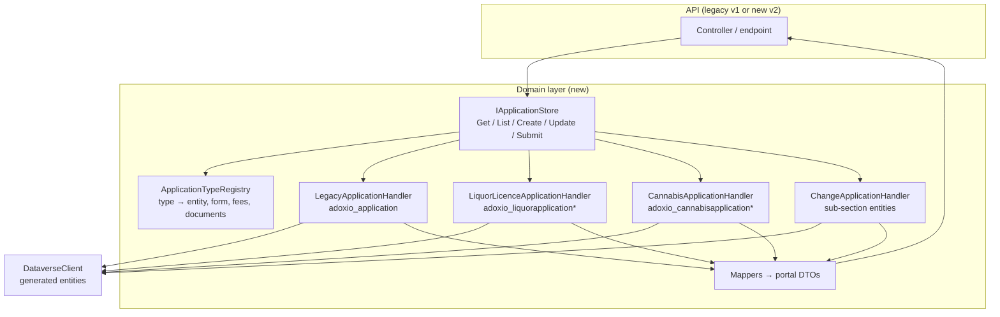
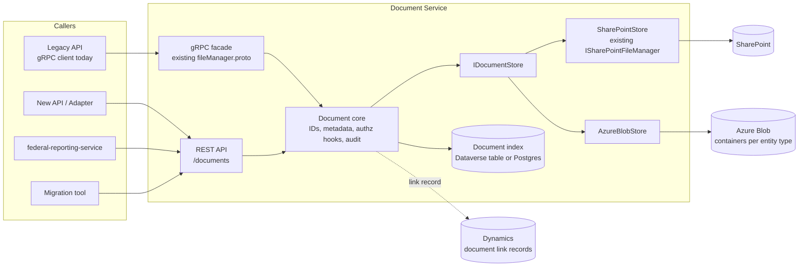
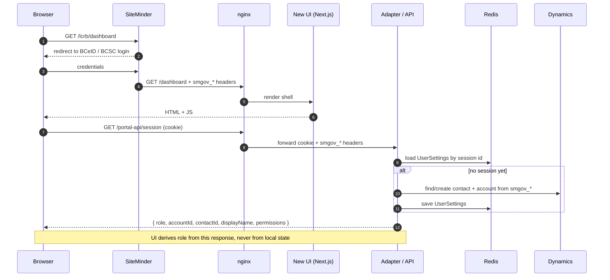
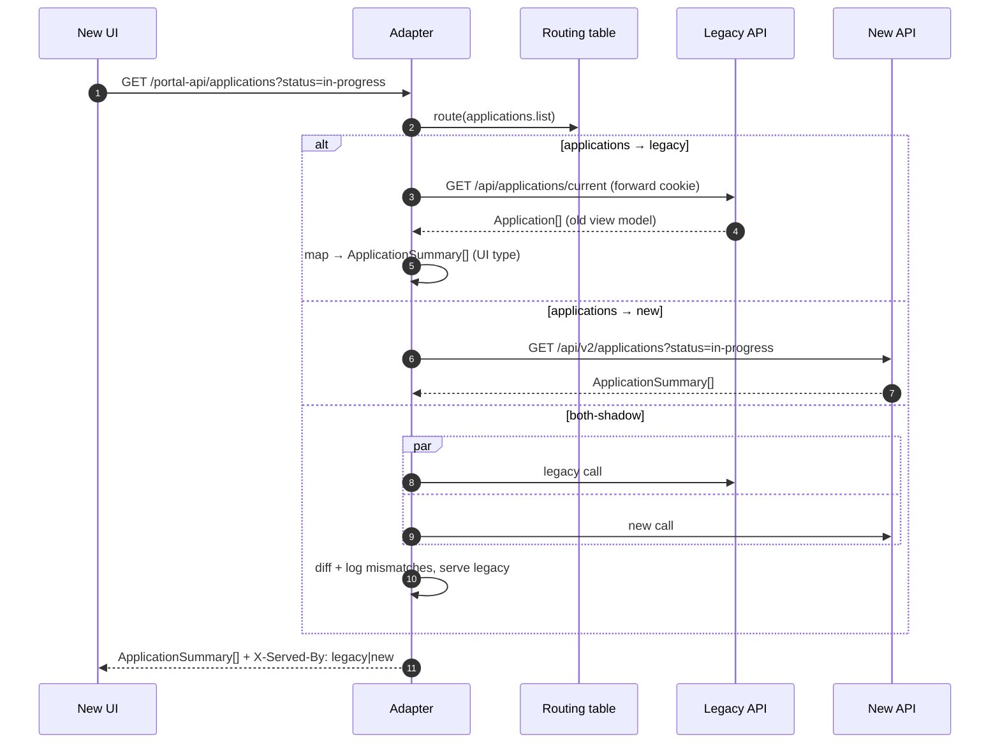
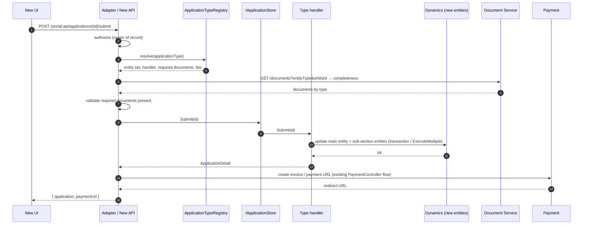
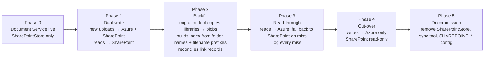

# CARLA Portal Modernization: Architecture Options

Draft for discussion. This document lays out candidate target architectures for the portal modernization and the transition path for each. It covers the code in this repository (everything that runs in OpenShift). Dynamics model changes are owned by the Dynamics team and are treated here as an external input with a contract we must consume.

Companion documents:

- [portal-modernization-plan.md](./portal-modernization-plan.md): the phased plan that builds on Option 1 below.
- [portal-redesign-dynamics-mapping.md](./portal-redesign-dynamics-mapping.md): which prototype pages map to which current APIs and entities (slices A to F).
- [portal-redesign-field-mapping.md](./portal-redesign-field-mapping.md): field-level mapping.
- [azure-document-storage-discovery.md](./azure-document-storage-discovery.md): SharePoint current state and draft document API.

Tags follow the convention from the mapping document: **[NEW]** is the prototype (`v0-liquor-license-portal-redesign`, Next.js); **[CURRENT]** is this repository.

---

## Contents

1. [Drivers and constraints](#1-drivers-and-constraints)
2. [Current state](#2-current-state)
3. [Target-state options](#3-target-state-options)
   - [Option 1: Adapter / BFF layer (strangler with translation)](#option-1-adapter--bff-layer-strangler-with-translation)
   - [Option 2: Evolve the existing API in place (versioned modules)](#option-2-evolve-the-existing-api-in-place-versioned-modules)
4. [Cross-cutting designs (apply to every option)](#4-cross-cutting-designs-apply-to-every-option)
5. [Flow diagrams](#5-flow-diagrams)
6. [Comparison](#6-comparison)
7. [Recommended direction](#7-recommended-direction)
8. [Phased roadmap](#8-phased-roadmap)
9. [Decisions needed](#9-decisions-needed)

---

## 1. Drivers and constraints

### 1.1 Drivers

| # | Change | Owner | What it means for this repo |
|---|---|---|---|
| D1 | **Dynamics model split.** `adoxio_application` (one entity for every application type) becomes several entities, by application type and/or by sub-section. | Dynamics team | Every read/write of `adoxio_application` must be re-pointed. Hot spots: [ApplicationsController](../cllc-public-app/Controllers/ApplicationsController.cs), the `Application` view model and its extensions, [DataverseClient](../cllc-interfaces/Dynamics-Dataverse/DataverseClient.cs), [FileController](../cllc-public-app/Controllers/FileController.cs) (document locations per entity), [federal-reporting-service](../federal-reporting-service), [carla-spice-sync-service](../carla-spice-sync-service), [watchdog](../watchdog). |
| D2 | **UI overhaul.** Angular 13 SPA replaced by the Next.js prototype. | This repo | New runtime (Node) in OpenShift, or a static export served by nginx. Prototype stores must be replaced by API clients. Real auth, authorization and document handling must be added (prototype has none). |
| D3 | **Storage move.** SharePoint to Azure Storage. | This repo (+ Dynamics for staff access) | [file-manager-service](../file-manager-service) and [cllc-interfaces/SharePoint](../cllc-interfaces/SharePoint) are the only SharePoint touch points. File identity (`serverRelativeUrl`), metadata-in-filename and `sharepointdocumentlocation` linkage all need a replacement. |
| D4 | **API changes** to serve D1 to D3. | This repo | New endpoints and view models shaped for the new UI and the new entities, while the Angular portal keeps working on the old ones until it is retired. |

### 1.2 Constraints

- **Both portals must run side by side** for the length of the transition. Features move one slice at a time.
- **SiteMinder is the authentication edge.** BCeID (`/lcrb/login`) and BC Services Card (`/lcrb/bcservice`) land on SiteMinder, which injects `smgov_*` headers. The API's [SiteminderAuthenticationHandler](../cllc-public-app/Authentication/SiteminderAuthenticationHandler.cs) turns those into a server-side session (`UserSettings`) backed by Redis. Any new component in the request path must preserve those headers and the session cookie.
- **The frontend nginx pod already proxies** `/api/`, `/login`, `/logout`, `/bcservice`, `/hc/` to the API ([nginx run script](../cllc-public-app/openshift/templates/nginx-runtime/s2i/bin/run)). It stays the single ingress and static host, but **feature-level routing between APIs is not its job**: nginx rules are opaque, deploy-time config with no translation, no shadowing and no per-request logic. Routing decisions belong in application code.
- **The API is .NET 8 legacy MVC** (`EnableEndpointRouting = false`, global NWebsec filters). Adding streaming or proxying behaviour inside it needs middleware rather than controllers (see [AgenticPlatformProxyMiddleware](../cllc-public-app/Middleware/AgenticPlatformProxyMiddleware.cs), which is already a small BFF).
- **Dynamics access is through the Dataverse SDK** (`ServiceClient`) in [cllc-interfaces/Dynamics-Dataverse](../cllc-interfaces/Dynamics-Dataverse) with generated entity classes ([adding-new-entities.md](./adding-new-entities.md)). New entities are a generation step plus client methods.
- **Other services depend on the same contracts**: federal-reporting-service and SPICE sync read applications and write files through File Manager gRPC. They must keep working through D1 and D3.
- **OpenShift**: anything new is a container image, a DeploymentConfig/Deployment, a Service and (optionally) a Route, plus network policies.

---

## 2. Current state



Points that shape the options:

1. The **frontend pod is the only thing the user's browser talks to**. Adding a new upstream (adapter or new UI) is a single `proxy_pass`; nginx is not asked to do anything finer than that.
2. **Session state is in Redis, keyed by cookie.** A second API or an adapter can share that session if it uses the same Data Protection key ring (`SetApplicationName("carla-public")` in [Startup.cs](../cllc-public-app/Startup.cs)) or if the adapter forwards the cookie and the old API stays the session owner.
3. **File Manager is already a seam.** Its gRPC contract hides SharePoint from every caller. Replacing the implementation behind the same contract isolates D3.
4. **The Dynamics model is not hidden.** Controllers work directly with generated entity classes and a very large `Application` view model. D1 lands squarely on this code.

---

## 3. Target-state options

Each option is a different *layout* of the same building blocks. For each one: a diagram, how it handles D1 to D4, the transition path, what it costs in OpenShift, and the trade-offs.

Shared vocabulary used below:

- **Legacy API**: today's `cllc-public-app` API (v1 routes, old entity model).
- **New API**: endpoints built for the new UI and the new Dynamics entities. Depending on the option, this is a separate deployable or a module inside the legacy API.
- **Document Service**: the storage-agnostic replacement for File Manager (SharePoint or Azure Blob behind one contract). See [4.3](#43-document-storage-sharepoint-to-azure).
- **New UI**: the Next.js app from the prototype, deployed in OpenShift.

---

### Option 1: Adapter / BFF layer (strangler with translation)

A dedicated **adapter** sits between the new UI and all backends. The new UI talks to exactly one API surface (`/portal-api/*` or similar), shaped for the UI. The adapter routes each operation to the legacy API or the new API based on a **routing table / feature flags**, and translates request and response shapes where the two differ. nginx only forwards `/portal-api/*` to the adapter as a whole; it never chooses between APIs. This is the layout described in the brief.



**Two placement variants**

| Variant | Where the adapter lives | When to choose |
|---|---|---|
| **1a. Standalone adapter service** (.NET 8, [YARP](https://microsoft.github.io/reverse-proxy/) for pass-through routes, minimal-API endpoints for translated routes) | Its own pod. The Next.js app is "dumb" and calls it over HTTP. | Team is strongest in .NET; want one place for authorization, correlation, and translation; want the UI to be swappable or statically exported. |
| **1b. BFF inside the Next.js server** (route handlers under `app/api/*` do the routing and translation; the Next server forwards cookies/headers) | Inside the New UI pod. No extra deployment. | Team is comfortable in TypeScript on the server; want to co-locate UI types and translators; accept that the Node pod is in the critical path for every API call. The prototype's `app/api/*` **[NEW]** routes and `proxy.ts` already run server-side, so this is a natural extension. |

A hybrid is possible (1b for UI-shape translation, 1a for cross-cutting proxying), but it doubles the hops; pick one.

**Adapter responsibilities (and non-responsibilities)**

| Does | Does not |
|---|---|
| Route per operation (path + method) to legacy or new, driven by config, not code. | Own business rules. Validation that belongs to the domain lives in the API. |
| Translate legacy view models to the **[NEW]** TypeScript types the UI imports (for example `Application` → `ApplicationSummary`, `SpecialEvent` → `SepRecord`). | Talk to Dynamics directly. |
| Forward the SiteMinder session cookie and `smgov_*` headers unchanged. | Mint identities. Authentication stays with SiteMinder + the API's handler. |
| Compose a UI page from several backend calls (dashboard = licences + applications + invoices). | Cache business data beyond request scope (keep it stateless). |
| Attach correlation IDs; emit routing decisions to logs/Splunk. | |

**Routing table sketch**

```yaml
# portal-adapter routes (illustrative)
routes:
  - id: sep-list
    match: { path: "/portal-api/special-events", methods: [GET] }
    target: legacy          # /api/special-events/current/submitted
    transform: SepListFromLegacy
  - id: sep-submit
    match: { path: "/portal-api/special-events/{id}/submit", methods: [POST] }
    target: legacy
  - id: applications-list
    match: { path: "/portal-api/applications", methods: [GET] }
    target: new             # /api/v2/applications (new entity model)
  - id: documents
    match: { path: "/portal-api/documents/{**rest}" }
    target: documents       # Document Service
flags:
  applications.useNewApi: true
  licences.useNewApi: false
```

**How it handles the drivers**

| Driver | Approach |
|---|---|
| D1 | The adapter is the anti-corruption layer. UI types stay stable while the backend swaps from `adoxio_application` to the per-type entities. A slice flips from `legacy` to `new` with a config change and a canary. |
| D2 | New UI codes against one stable contract. Prototype `lib/data/*` **[NEW]** modules become thin API clients. |
| D3 | Document routes go to the Document Service from day one; the adapter never sees SharePoint concepts. |
| D4 | New API endpoints are designed for the new entities without worrying about the legacy shapes. The adapter absorbs the difference. |

**Transition path**

1. Stand up the adapter with pass-through routes only (YARP). Point New UI at it. Nothing is translated yet; this proves session passthrough and routing.
2. Slice A (SEP) on legacy via translators. Ship the new SEP pages to a pilot group.
3. Build New API for Slice B (applications) on the new entities. Flip `applications.useNewApi` per environment.
4. Repeat per slice. Legacy routes disappear from the table as they are retired.
5. When the table has no `legacy` targets and Angular is gone, the adapter can either stay (as the stable public contract) or be folded into the New API.

**Trade-offs**

- Cleanest decoupling of UI from backend churn. Routing is data, so feature cut-over is a config change with instant rollback.
- One extra hop and one extra deployable. Translation code is real code with tests; the mapping tables in the companion documents become its spec.
- Risk of the adapter becoming a second business layer. Mitigate with the "does / does not" table above and code review rules.
- Session passthrough must be designed early (see [4.1](#41-identity-session-and-authorization)).

**OpenShift footprint**: +1 New UI, +1 adapter (1a only), +1 New API (or module), Document Service, ConfigMap for routing table, network policies for adapter → APIs.

---

### Option 2: Evolve the existing API in place (versioned modules)

No new API deployable and no adapter. The legacy `cllc-public-app` gains **v2 controllers / minimal-API modules** built on the new entities and shaped for the new UI, side by side with the existing v1 controllers. Both UIs talk to the same pod.



**How it handles the drivers**

| Driver | Approach |
|---|---|
| D1 | Introduce a domain layer (`IApplicationStore`, per-type handlers) inside the app. v1 controllers are refactored to use it with the old entity; v2 modules use it with the new entities. One codebase, one place to switch. |
| D2 | New UI deployed as its own pod, calling `/api/v2`. |
| D3 | Document Service replaces File Manager; the app changes its client. |
| D4 | v2 endpoints added per slice in the same solution. |

**Transition path**

1. Add the domain layer and the first v2 module (SEP) to the app. No infra change other than the New UI pod.
2. Add v2 modules per slice.
3. Delete v1 controllers as Angular pages are retired.

**Trade-offs**

- Lowest infrastructure cost and no session-sharing problem: one process owns the session.
- Reuses all existing plumbing (SiteMinder handler, Dataverse client, payment, PDF).
- The legacy app is large and MVC-legacy (`EnableEndpointRouting = false`); adding minimal APIs and modern patterns next to it is possible but constrained. Every v2 deploy redeploys v1; blast radius is the whole portal.
- Harder to retire. The "temporary" shared codebase tends to persist.
- No UI-side contract stability: v2 shape changes hit the new UI directly.

**OpenShift footprint**: +1 New UI. Document Service replaces File Manager. No other change.

---

## 4. Cross-cutting designs (apply to every option)

### 4.1 Identity, session and authorization

Today: SiteMinder authenticates at the edge and injects `smgov_*` headers. [SiteminderAuthenticationHandler](../cllc-public-app/Authentication/SiteminderAuthenticationHandler.cs) reads them, looks up or creates the Dynamics contact/account, and stores `UserSettings` in the server-side session (Redis). Authorization policies (`Business-User`, `Can-Create-Account`) and `UserSettings` drive every controller.

Design principles for the new layout:

1. **SiteMinder stays the authenticator.** No Keycloak/Entra change is in scope. The new UI must live under the SiteMinder-protected paths (`/lcrb/*`) or an equivalent agent configuration.
2. **One session owner.** Whichever process first sees the `smgov_*` headers owns session creation. Options:
   - *Legacy API owns it* (Option 1): the adapter / new API forward the session cookie to the legacy API's `/api/user/current` (or a new `/api/session` endpoint) to resolve identity. Simple, but couples everything to the legacy API until the end.
   - *Shared session library*: extract the SiteMinder handler and `UserSettings` from `cllc-public-app` into `cllc-interfaces/Authentication` so the new API (and adapter) decode the same cookie using the same Data Protection application name (`carla-public`) and Redis key ring. Recommended for Option 1a once the New API exists; unnecessary for Option 2.
3. **Authorization is server-side and record-scoped.** The prototype gates UI by role only (see its `DEVELOPER_HANDOFF.md` §7). Every API must enforce: role (licensee / applicant / police / LG / IN), ownership (account/contact on the record) and jurisdiction scoping (police and LG queues). Centralize this in a policy library reused by legacy and new APIs. The current per-entity `switch` in `FileController.CanAccessEntity` is the pattern to replace.
4. **Next.js server-side rendering must forward cookies.** Any fetch performed during SSR must copy the incoming `Cookie` header (and `smgov_*` headers, if the adapter needs them) to the backend call. Client-side fetches get this for free (same origin).
5. **Roles come from claims and Dynamics, not from the UI.** `lib/roles.ts` **[NEW]** becomes a pure label map; the role is returned by a `/session` endpoint.



### 4.2 Dynamics model split (D1): anti-corruption layer

The repository should not let the Dynamics entity shape leak into controllers or the UI again. Introduce an **application domain layer** in `cllc-interfaces` (or a new `cllc-domain` project) that both legacy and new code use:



Rules:

- **One `ApplicationTypeRegistry`** (config or `adoxio_applicationtype` metadata) says, for each application type: which Dynamics entity (or entity set) holds it, which handler, which form definition, which document types, and whether the type is served by legacy or new storage during transition. This replaces today's giant `switch`/`if` chains on `ApplicationType`.
- **Portal DTOs are the contract**, not generated entities. `Application` view model (hundreds of fields) is split into DTOs per type and per sub-section, matching the **[NEW]** types in the prototype's `lib/data/applications.ts` where sensible.
- **Dual-read during migration.** While some types still live in `adoxio_application`, `IApplicationStore.List` fans out to all handlers and merges. Writes go to exactly one handler chosen by the registry.
- **Document locations follow the entity.** Each new entity needs a Document Service "entity type" mapping (and, if `sharepointdocumentlocation` survives, a library). The registry carries this too.
- **Downstream services** (federal reporting, SPICE sync, watchdog, LDB orders) consume the domain layer rather than re-implementing entity knowledge.
- **Entity generation**: new entities are added through [generate-entities.ps1](../generate-entities.ps1) as described in [adding-new-entities.md](./adding-new-entities.md); generated code remains untouched.

### 4.3 Document storage: SharePoint to Azure

Build on the draft in [azure-document-storage-discovery.md](./azure-document-storage-discovery.md) §4. The **Document Service** is the evolution of `file-manager-service`:



Design points:

- **Keep the gRPC facade** so the legacy API and federal reporting keep working unchanged; add the REST `/documents` contract for new callers. Both call the same core.
- **Stable document ID.** Replace `serverRelativeUrl` with an opaque `documentId`. The blob path (`{entityType}/{entityId}/{documentId}`) and the metadata (document type, original filename, hash, uploader, uploaded-from-portal) live in blob metadata/tags and in a small index so listing and completeness checks (`documentStatus`) do not need to enumerate blobs or parse filenames.
- **Compatibility read.** Files migrated from SharePoint keep their `{documentType}__{name}` convention in the index so `parseFileName` **[CURRENT]** and the prototype's document manager both work.
- **Upload path.** Two choices, both valid: (a) proxied through the Document Service (simplest, keep the current MIME sniffing, memory concern addressed by streaming); (b) direct-to-blob with a short-lived SAS issued by the Document Service after authorization, then a confirm call. (b) scales better for large files; (a) is a smaller change. Start with (a), keep (b) as an option in the contract.
- **Dynamics linkage.** The open decision from the discovery document stands: either keep writing `sharepointdocumentlocation`-style link records that point at the new location, or add a custom `adoxio_document` table that the Dynamics team surfaces to staff. This is the one piece of D3 that is not purely in this repo.
- **Dynamics side effects preserved.** Uploads still set `adoxio_FileUploadedFromPortal` and bump `modifiedon`; the hook lives in the Document core, not in each caller.
- **Migration**: see flow [5.5](#55-document-migration-sharepoint-to-azure).
- **Local dev**: `DISABLE_SHAREPOINT_INTEGRATION` becomes an `InMemoryStore` or Azurite.

### 4.4 Feature routing and flags

Regardless of option, the transition needs an explicit "who serves what" table, versioned in git and applied per environment:

- Keyed by **slice** (SEP, Applications, Licences, Business Structure, LG review, Account) and, within Applications, by **application type**.
- Values: `legacy | new | both-shadow` (call both, serve legacy, compare and log differences; useful before flipping a type).
- Lives in a ConfigMap mounted into the adapter (Option 1) or read by the API at startup (Option 2). Never in nginx config. Avoid a database for this; it should be reviewable and rollback-able with a deploy.

### 4.5 Observability

- Correlation ID generated at nginx (or the adapter) and propagated to every backend and to Dynamics calls (`x-ms-client-request-id`). Logged to Splunk alongside the routing decision.
- Health endpoints on every new deployable; [watchdog](../watchdog) extended to cover them.
- Route-level metrics: per-slice legacy vs new hit counts to see migration progress.

### 4.6 New UI hosting

The prototype is Next.js (App Router, server components, `app/api/*` route handlers, `proxy.ts`). Two ways to run it in OpenShift:

| Mode | How | Fits |
|---|---|---|
| **Node server (SSR)** | `next build` + `next start` in a Node image behind nginx. | Required for Option 1b and for any `app/api/*` server routes (AI assistant, PDF). Adds a Node runtime to operate. |
| **Static export** | `output: "export"`, served by the existing nginx-runtime image like Angular today. | Only works if every server-only feature (route handlers, server components reading cookies) is removed or moved to the adapter/API. Fits Options 1a and 2 with a .NET backend doing all the work. |

The prototype's AI routes call the Vercel AI Gateway. In OpenShift they should be redirected to the LCRB agentic platform through the existing [AgenticPlatformProxyMiddleware](../cllc-public-app/Middleware/AgenticPlatformProxyMiddleware.cs) pattern, or dropped from the first release. Treat AI as its own slice.

---

## 5. Flow diagrams

### 5.1 Login and session bootstrap (new UI)



### 5.2 Adapter routing: legacy vs new (Option 1)



### 5.3 Submit an application on the new entity model (D1)



### 5.4 Document upload to Azure (D3)

```mermaid
sequenceDiagram
    autonumber
    participant UI as New UI
    participant X as Adapter / API
    participant DOC as Document Service
    participant AZ as Azure Blob
    participant IDX as Document index
    participant D as Dynamics

    UI->>X: POST /portal-api/documents (multipart: entityType, entityId, documentType, file)
    X->>X: authorize caller against entity
    X->>DOC: POST /documents (stream)
    DOC->>DOC: sniff MIME (PNG/JPEG/PDF), size limit, sanitize name, hash
    DOC->>AZ: PUT blob {entityType}/{entityId}/{documentId} + metadata
    DOC->>IDX: insert {documentId, entity, documentType, name, hash, uploader}
    DOC->>D: ensure link record; set adoxio_FileUploadedFromPortal, bump modifiedon
    DOC-->>X: { documentId, name, documentType, size, uploadedOn }
    X-->>UI: document
    Note over DOC,D: link-record failure is retried/reconciled, never silent (sync-tool lesson)
```

### 5.5 Document migration: SharePoint to Azure



The existing [sharepoint-sync-tool](../sharepoint-sync-tool) is the seed for the Phase 2 migration tool: it already walks libraries and reconciles document-location records.

---

## 6. Comparison

| Criterion | 1. Adapter / BFF | 2. In-place v2 |
|---|---|---|
| New deployables | UI, Adapter, New API | UI |
| UI isolated from backend churn (D1) | **Yes** | No |
| Per-feature cut-over / rollback | **Config change** | Deploy |
| Session complexity | Cookie passthrough, legacy owns session initially | **None** |
| Translation code to maintain | Yes (adapter) | None |
| Blast radius of a v2 deploy | New API only | **Whole portal** |
| Fit with Dynamics entity split | **Good, isolated from UI** | OK |
| Retirement of legacy | Clear | Hard |
| Team/ops load | Medium | **Low** |
| Time to first slice (SEP) | Short–medium | **Shortest** |
| Long-term shape | Adapter can become the public API | One large API |

---

## 7. Recommended direction

**Option 1a (standalone .NET adapter) + a single New API built as a modular monolith**, with the Document Service carved out first. In detail:

1. **Adapter (`portal-adapter`)**: .NET 8, YARP for pass-through, minimal-API endpoints for translated/composed routes, routing table from ConfigMap, cookie/header passthrough, correlation IDs. Stateless. Starts as a pure proxy.
2. **New API (`portal-api`)**: .NET 8 minimal API, organised as modules by domain (Applications, Licensing, SpecialEvents, BusinessStructure, Account) over the shared domain layer from [4.2](#42-dynamics-model-split-d1-anti-corruption-layer). One deployable; module boundaries keep the code organised by domain without adding services.
3. **Document Service**: evolve `file-manager-service` as in [4.3](#43-document-storage-sharepoint-to-azure). Independent of UI work, so it can start immediately.
4. **Shared libraries in `cllc-interfaces`**: Authentication (SiteMinder handler + `UserSettings` + authorization policies), Domain (registry, stores, DTOs), Dataverse (existing).
5. **New UI**: Next.js in Node mode behind nginx, calling only `/portal-api/*`. The prototype's `app/api/*` routes are either removed or reduced to thin proxies to the adapter.
6. **Legacy API and Angular**: frozen; only bug fixes and the Document Service client swap.

Why this over Option 2: it is the only layout that keeps the UI stable while the Dynamics model is in flux (the biggest external risk) and gives config-driven cut-over per application type, owned by application code rather than the edge proxy. Option 2 is the fallback if headcount is tight: the same domain layer and v2 endpoints can live in `cllc-public-app` and move out later.

---

## 8. Phased roadmap

Aligned with slices A–F from [portal-redesign-dynamics-mapping.md](./portal-redesign-dynamics-mapping.md) §10.

| Phase | Scope | Exit criteria |
|---|---|---|
| **0. Foundations** | Shared auth library; adapter as pure proxy; New UI shell deployed under SiteMinder; `/session` endpoint; routing table; correlation IDs; Document Service with SharePoint store behind REST + gRPC. | New UI shows the authenticated shell in DEV/TEST against legacy APIs. No feature pages. |
| **1. Slice A: Special Event Permits** | Adapter translators for SEP (full legacy API exists); police queue; SEP documents through Document Service; payment through existing `SepPaymentController`. | SEP applicants and police can complete the full flow in the new UI. Angular SEP pages still available. |
| **2. Documents to Azure** | Azure Blob store; dual-write; backfill; read-through; cut-over (flow 5.5). Runs in parallel with Phase 1. | All reads served from Azure; SharePoint read-only. |
| **3. Slice B/C: Applications and Licences on the new entities** | Domain layer; `ApplicationTypeRegistry`; New API modules; per-type flip from legacy to new via routing table; dual-read listing. | Each application type flipped individually; legacy `adoxio_application` reads only for unmigrated types. |
| **4. Slices D/E/F** | Business structure, LG review, account and delegates. | Angular pages for these slices retired. |
| **5. Decommission** | Remove Angular, legacy controllers, SharePoint code, SPICE/federal reporting repointed to domain layer and Document Service. | Routing table has no `legacy` target. |

Each phase ships behind the routing table so a slice can be reverted without a rollback deploy.

---

## 9. Decisions needed

| # | Decision | Affects | Suggested owner |
|---|---|---|---|
| 1 | Adopt Option 1a, or fall back to Option 2? | Everything | Architecture + team leads |
| 2 | New UI hosting: Node SSR pod vs static export | UI, adapter design, ops | Dev team + platform |
| 3 | Session ownership: legacy API owns it initially vs shared auth library from day one | Adapter, New API | Dev team |
| 4 | Document ID and index location (Dataverse table vs Postgres in OpenShift) | Document Service, Dynamics staff experience | Dev team + Dynamics team |
| 5 | How staff access documents in Dynamics after SharePoint (link records vs custom table vs viewer) | D3 | Dynamics team + client |
| 6 | Timeline and contract (entity names, relationships, status option sets) for the per-type application entities | Domain layer, Phase 3 | Dynamics team |
| 7 | Where form/flow definitions live: Dynamics form metadata vs portal-owned config (mapping doc decision 1) | Slices A, B | Product + Dynamics team |
| 8 | AI features in first release: drop, or proxy to the LCRB agentic platform | UI, security review | Product |
| 9 | Direct-to-blob upload (SAS) in scope for v1 of the Document Service | Document Service | Dev team |
| 10 | Which downstream services (SPICE sync, federal reporting, LDB orders) must switch to the domain layer, and when | Phase 3/5 | Dev team |
