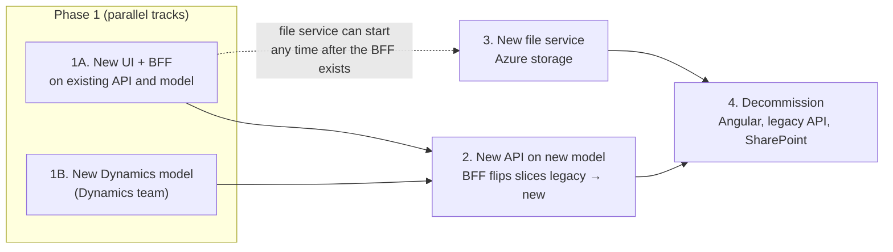
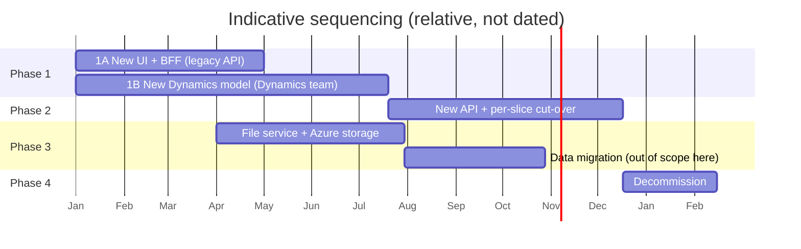
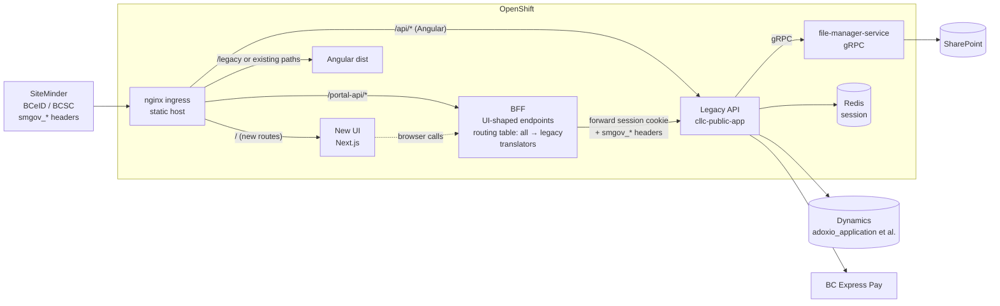
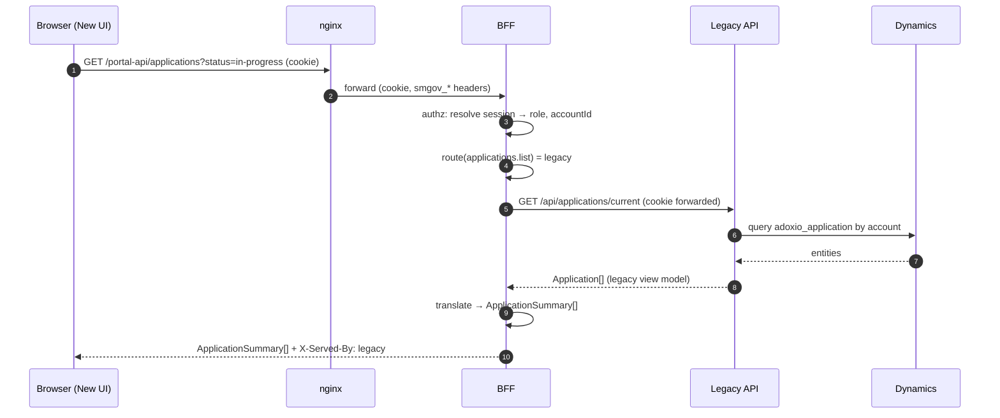
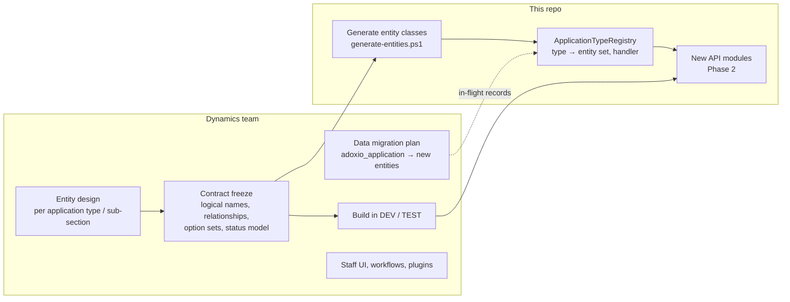
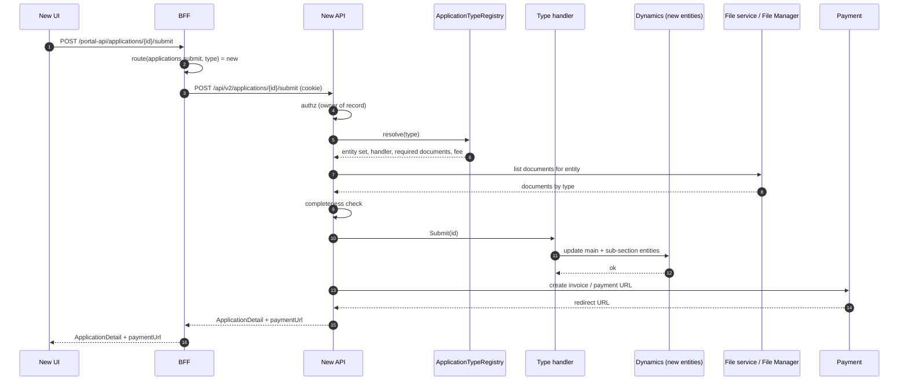
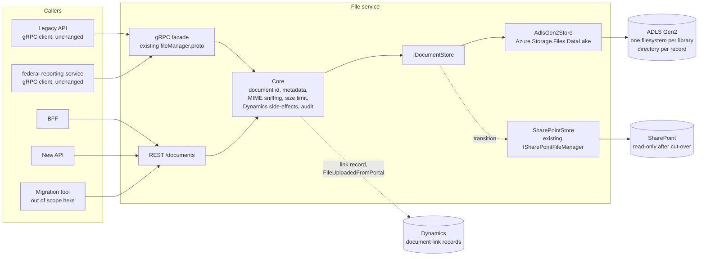
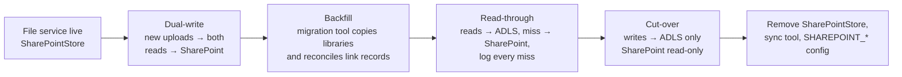
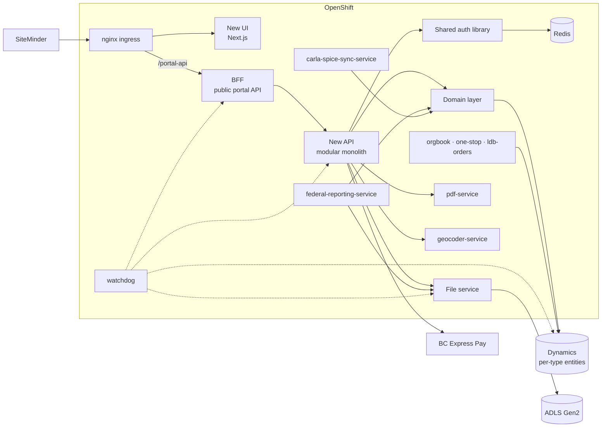

# CARLA Portal Modernization: Phased Plan

Working plan for the portal modernization. It takes the adapter / BFF layout from [portal-modernization-architecture-options.md](./portal-modernization-architecture-options.md) (Option 1) and lays out how we get there in phases. Feature-level mapping is in [portal-redesign-dynamics-mapping.md](./portal-redesign-dynamics-mapping.md) and [portal-redesign-field-mapping.md](./portal-redesign-field-mapping.md); storage current state is in [azure-document-storage-discovery.md](./azure-document-storage-discovery.md).

Tags: **[NEW]** = prototype (`v0-liquor-license-portal-redesign`, Next.js); **[CURRENT]** = this repository.

---

## Contents

1. [Strategy in one picture](#1-strategy-in-one-picture)
2. [Principles](#2-principles)
3. [Phase 1A: New UI on the existing API, through a BFF](#3-phase-1a-new-ui-on-the-existing-api-through-a-bff)
4. [Phase 1B: New Dynamics model (parallel)](#4-phase-1b-new-dynamics-model-parallel)
5. [Phase 2: New API on the new model, migrated slice by slice](#5-phase-2-new-api-on-the-new-model-migrated-slice-by-slice)
6. [Phase 3: New file service on Azure storage](#6-phase-3-new-file-service-on-azure-storage)
7. [Phase 4: Decommission](#7-phase-4-decommission)
8. [Gaps: what the four-phase outline does not yet cover](#8-gaps-what-the-four-phase-outline-does-not-yet-cover)
9. [End state](#9-end-state)
10. [Decisions to make before Phase 1A starts](#10-decisions-to-make-before-phase-1a-starts)

---

## 1. Strategy in one picture





The BFF is the hinge of the whole plan. It is built in Phase 1A against the legacy API, then in Phase 2 becomes the switch that moves each slice to the new API without the UI noticing. In Phase 3 it is the single caller of the new file service.

---

## 2. Principles

1. **The new UI only ever talks to the BFF.** No direct calls to `/api/*` legacy routes or to the new API. The BFF contract is shaped for the UI (the **[NEW]** TypeScript types the pages already import), not for Dynamics.
2. **Routing between old and new is application code and config, not nginx.** nginx stays the single ingress and static host.
3. **One slice at a time.** Slices are the ones in the mapping document: A SEP, B Applications, C Licences, D Business structure, E LG review, F Account. Each slice has its own BFF endpoints and its own `legacy | shadow | new` switch.
4. **Prune the prototype first, extend later.** Phase 1A ships only features the current API and model can back. Prototype-only features are parked, not half-wired.
5. **Dynamics shape never leaks past the BFF / new API.** The UI types are the contract; translation lives in one place.
6. **Both portals run side by side** until Phase 4. Angular keeps working against the legacy API untouched.

---

## 3. Phase 1A: New UI on the existing API, through a BFF

**Goal.** Replace the Angular portal page by page with the Next.js UI, without changing the legacy API, the Dynamics model or storage.

### 3.1 Architecture



Nothing to the right of the BFF changes in this phase.

### 3.2 BFF design

```mermaid
flowchart TB
    subgraph BFF
        EP[UI-shaped endpoints<br/>/portal-api/applications, /special-events, /licences, /session ...]
        RT[Routing table<br/>per slice (and per application type in Phase 2)<br/>legacy | shadow | new]
        TR[Translators<br/>legacy view model → UI type<br/>UI type → legacy request]
        CMP[Composers<br/>dashboard = licences + applications + invoices]
        AUTHZ[Authorization guard<br/>role, ownership, jurisdiction]
        FWD[Upstream client<br/>cookie + smgov_* passthrough<br/>correlation id, timeouts, retries]
    end
    EP --> AUTHZ --> RT
    RT --> TR --> FWD
    RT --> CMP --> FWD
```

| Does | Does not |
|---|---|
| Expose one endpoint per UI need, returning the **[NEW]** types (`SepRecord`, `ApplicationSummary`, `LicenceRecord` ...). | Talk to Dynamics or SharePoint directly. |
| Route each endpoint to legacy (Phase 1A) or new (Phase 2) from config. | Own business rules or validation that belongs in the API. |
| Translate shapes and status codes (status translation tables from the mapping document, decision 2). | Cache business data beyond the request. |
| Forward the SiteMinder session cookie and `smgov_*` headers unchanged. | Mint identities or sessions. |
| Enforce role / ownership / jurisdiction for what it returns (defence in depth; the API still enforces too). | |
| Compose multi-call pages. | |
| Attach a correlation id to every upstream call and log the routing decision. | |

**Placement** (decision 1 in section 10):

| | 1a. Standalone .NET 8 service (YARP + minimal API) | 1b. Inside the Next.js server (`app/api/*` route handlers) |
|---|---|---|
| Deployables | +1 | 0 |
| Language | C#, reuses `cllc-interfaces` view models and, later, the shared auth library | TypeScript, co-located with the UI types it returns |
| UI hosting | UI can be a static export | UI must run as a Node server |
| Phase 2 fit | New API is also .NET; shared DTO project possible | Translators duplicated in TS; OpenAPI client generation mitigates |

### 3.3 Prototype pruning

Based on the prototype `FEATURES.md` and mapping document section 9.

| Keep in Phase 1A (API exists) | Park (no current API or model) |
|---|---|
| Dashboard (licences, applications, recent activity) | AI layer: assistant, licence finder, planner advisor, nudges, status explainer, reviewer brief, assessment, document check, adverse media, activity search |
| My Applications, submitted detail, application documents, catalog (filtered to current application types) | Establishment Planner, Section 119 evaluator, licence-cap engine |
| Dynamic application flow (only where form definitions can be sourced; decision 5) | Compliance & Enforcement, Notices, Announcements, Calendar (no entities confirmed) |
| Licence list and detail, licence actions that map to current application types | LCRB staff surface (`/lcrb/*`); staff work in Dynamics |
| Special Event Permits: applicant and police surfaces | Analytics, activity console, one-door, gate |
| Local / Indigenous government review queue (reconcile decision set) | Notification centre and preferences (no entity) |
| Legal entity, tied house, security screening (partial; confirm with field mapping) | Delegated users with access levels (current flags differ) |
| Account profile | Vercel Blob upload routes (`/api/upload`, `/api/file`); replaced by BFF document endpoints |
| Payment and receipt | Role switcher `/login`, access-code `/gate` |
| Map (if `EstablishmentsController` `map` suffices) | |

Parked features stay in the code base behind a feature flag or are removed from the route tree; either way they are not reachable in production.

### 3.4 Request flow



### 3.5 Deliverables and exit criteria

Deliverables:

- New UI image and build pipeline in OpenShift (Node SSR or static export, per decision 2); SiteMinder agent configuration for the new paths.
- BFF with `/session`, Slice A (SEP + police) first, then B/C, then D/E/F, each routed to legacy.
- Prototype stores (`components/providers/*-store-provider.tsx`, `lib/services/*-store.ts`, `lib/data/*` seeds) **[NEW]** replaced by typed BFF clients; `kv-store.ts` removed.
- Authorization in the BFF and confirmation that the legacy API enforces the same rules.
- Correlation ids end to end; watchdog covers the new pods.
- Contract tests for every translator (legacy fixture → expected UI type).

Exit: every kept feature works end to end in the new UI against the legacy API in TEST; a pilot group uses the new UI in PROD; Angular remains available.

### 3.6 Risks

- **Prototype has no auth, authz or server-side validation.** This is new work, not porting.
- **Form definitions.** The prototype's config-driven flows **[NEW]** and the current Dynamics form metadata (`FormsController`, `ApplicationTypesController`) **[CURRENT]** are different approaches. Decide before Slice B.
- **Payment return URLs.** BC Express Pay redirects back to the portal; the legacy `PaymentController` / `SepPaymentController` return paths must land on the new UI for new-UI users.
- **Two UIs, one session.** Users may bounce between portals; both must accept the same SiteMinder session.

---

## 4. Phase 1B: New Dynamics model (parallel)

Owned by the Dynamics team. What this repository needs from it, and when.



Inputs we need:

| Input | Needed for | Needed by |
|---|---|---|
| Contract freeze: entity logical names, parent/child relationships, which `adoxio_application` fields move where | Entity generation ([adding-new-entities.md](./adding-new-entities.md)), DTO design | Before Phase 2 starts |
| Status / option-set model per entity | BFF status translation, UI badges | Before Phase 2 starts |
| Which entities carry documents (document location relationships) | Phase 2 document handling, Phase 3 container layout | Before Phase 2 Slice B |
| Data migration approach for existing and in-flight applications: big-bang per type, or old and new coexisting | Dual-read in the registry; routing table granularity (per type vs per record) | Before Phase 2 cut-over of the first type |
| Fields the portal writes that trigger Dynamics workflows (for example `adoxio_FileUploadedFromPortal`) and their new homes | Side-effect preservation | Before Phase 2 Slice B |
| Impact on downstream readers: federal reporting, SPICE sync, LDB orders, watchdog | Section 8, item 5 | Before any type is cut over |

---

## 5. Phase 2: New API on the new model, migrated slice by slice

**Goal.** Build the new API against the new entities and use the BFF routing table to move each slice (and within Applications, each application type) from legacy to new.

### 5.1 Architecture

```mermaid
flowchart LR
    SM[SiteMinder] --> NG

    subgraph OpenShift
        NG[nginx]
        UI_NEW[New UI]
        UI_OLD[Angular dist]
        BFF[BFF<br/>routing table:<br/>SEP → new, Applications(type X) → new,<br/>Applications(type Y) → legacy, ...]
        API_OLD[Legacy API]
        API_NEW[New API<br/>.NET 8, modular monolith<br/>Applications · Licensing · SEP · BusinessStructure · Account]
        DOM[Domain layer<br/>ApplicationTypeRegistry<br/>IApplicationStore + per-type handlers]
        AUTH[Shared auth library<br/>SiteMinder session + policies]
        FM[file-manager-service]
        REDIS[(Redis)]
    end

    DYN_OLD[(Dynamics<br/>adoxio_application<br/>unmigrated types)]
    DYN_NEW[(Dynamics<br/>new per-type entities)]
    SP[(SharePoint)]

    NG --> UI_NEW & UI_OLD
    NG -->|/portal-api| BFF
    NG -->|/api| API_OLD
    BFF -->|legacy slices| API_OLD
    BFF -->|migrated slices| API_NEW
    API_OLD --> AUTH
    API_NEW --> AUTH
    AUTH --> REDIS
    API_NEW --> DOM
    DOM --> DYN_NEW
    DOM -.dual-read for<br/>unmigrated types.-> DYN_OLD
    API_OLD --> DYN_OLD
    API_OLD & API_NEW -->|gRPC| FM --> SP
```

### 5.2 Domain layer (anti-corruption)

```mermaid
flowchart TB
    EP[New API endpoint]
    REG[ApplicationTypeRegistry<br/>type → entity set, handler, form, documents, fees,<br/>storage: legacy | new]
    ST[IApplicationStore<br/>Get / List / Create / Update / Submit]
    H1[LegacyHandler<br/>adoxio_application]
    H2[LiquorHandler<br/>new liquor entities]
    H3[CannabisHandler<br/>new cannabis entities]
    H4[ChangeHandler<br/>sub-section entities]
    DV[DataverseClient<br/>generated entities]
    DTO[Portal DTOs = UI types]

    EP --> ST --> REG
    ST --> H1 & H2 & H3 & H4 --> DV
    H1 & H2 & H3 & H4 --> DTO --> EP
```

- `List` fans out to every handler whose types the account can hold and merges; `Create`/`Update`/`Submit` go to exactly one handler chosen by the registry.
- The registry is the one place that knows a type's storage. The BFF routing table and the registry must agree; generate one from the other or share the config.
- Downstream services (section 8, item 5) consume `IApplicationStore`, not entities.

### 5.3 Per-slice cut-over

```mermaid
flowchart LR
    S0[legacy<br/>BFF → legacy API] --> S1
    S1[shadow<br/>BFF calls both,<br/>serves legacy,<br/>diffs and logs] --> S2
    S2[new (TEST)<br/>BFF → new API] --> S3
    S3[new (PROD, canary)<br/>pilot accounts only] --> S4
    S4[new (PROD, all)]
    S1 -. mismatch found .-> S0
    S3 -. defect .-> S2
```

Granularity: per slice for SEP, Licences, Business structure, LG review, Account; **per application type** for Applications, because the Dynamics migration lands type by type.

### 5.4 Sequence: submit an application on the new model



### 5.5 Deliverables and exit criteria

- Shared auth library extracted from `cllc-public-app` (SiteMinder handler, `UserSettings`, policies) into `cllc-interfaces`, used by both APIs.
- Domain layer and registry; generated entity classes for the new model.
- New API modules per slice; OpenAPI spec consumed by the BFF.
- Routing table extended to application type.
- Shadow-mode diff reports per slice before each flip.
- Downstream services repointed to the domain layer for migrated types.

Exit: every slice and every application type served by the new API in PROD; the legacy API receives traffic only from Angular.

---

## 6. Phase 3: New file service on Azure storage

**Goal.** Replace `file-manager-service` + SharePoint with a file service over Azure Data Lake Storage Gen2, keeping the same operations the portal relies on (create folder, upload, list by prefix, download, delete, exists).

Can start any time after the BFF exists; it does not depend on Phase 2. The hierarchical namespace in ADLS Gen2 maps directly to today's `{library}/{Name}_{GUID}/{documentType}__{file}` layout, which is why the portal-side change is small.

### 6.1 Architecture



### 6.2 What changes and what does not

| Stays the same | Changes |
|---|---|
| Operations: create folder, upload, list by prefix, download, delete, exists | Storage SDK: Graph/REST → `Azure.Storage.Files.DataLake` |
| Folder-per-record layout, `{documentType}__{name}` convention (kept for compatibility) | File identity: `serverRelativeUrl` → opaque `documentId` (path kept as an attribute) |
| gRPC contract for legacy callers | Document type also stored as metadata, not only in the filename |
| MIME allow-list (PNG/JPEG/PDF), filename sanitising | Path-length truncation logic removed |
| `adoxio_FileUploadedFromPortal` + `modifiedon` bump on upload | Auth to storage: Entra workload identity / managed identity instead of SharePoint credentials |
| `DISABLE_SHAREPOINT_INTEGRATION` stub for local dev | Becomes Azurite / in-memory store |
| | Dynamics staff access to files (section 8, item 7) |

### 6.3 Upload flow

```mermaid
sequenceDiagram
    autonumber
    participant UI as New UI
    participant BFF as BFF
    participant FS as File service
    participant AZ as ADLS Gen2
    participant D as Dynamics

    UI->>BFF: POST /portal-api/documents (entityType, entityId, documentType, file)
    BFF->>BFF: authz: caller owns entity
    BFF->>FS: POST /documents (stream)
    FS->>FS: sniff MIME, size limit, sanitise, hash
    FS->>AZ: create {library}/{record}/{documentType}__{name} + metadata
    FS->>D: ensure link record; set FileUploadedFromPortal; bump modifiedon
    FS-->>BFF: { documentId, name, documentType, size, uploadedOn }
    BFF-->>UI: document
```

### 6.4 Cut-over (portal side only; data migration is someone else's task but gates the switch)



Exit: all reads and writes served from ADLS Gen2; SharePoint read-only; no `SHAREPOINT_*` configuration in OpenShift.

---

## 7. Phase 4: Decommission

- Remove Angular build, `cllc-public-frontend`, and the `/api/*` nginx proxy to the legacy API.
- Remove legacy controllers once the BFF routing table has no `legacy` target. Keep `cllc-public-app` only if the shared auth library and remaining utilities still live there; otherwise retire it.
- Remove SharePoint projects, `sharepoint-sync-tool`, and the dead SharePoint wiring in `carla-spice-sync-service`.
- Decide whether the BFF stays as the public portal API or is folded into the new API (one hop fewer). Keeping it preserves the UI contract independence that paid for itself in Phase 2.

---

## 8. Gaps: what the four-phase outline does not yet cover

Items that are implied but need to be explicit, roughly in the order they bite.

| # | Gap | Why it matters | Where it lands |
|---|---|---|---|
| 1 | **Identity and session for the new UI.** SiteMinder must protect the new UI's paths; the BFF must forward the session cookie and `smgov_*` headers; a `/session` endpoint returns role, account and contact so the UI never derives role from local state. | Day one of Phase 1A. The prototype's `lib/roles.ts` and `session-provider.tsx` **[NEW]** are mocks. | Phase 1A |
| 2 | **Authorization.** The prototype gates UI by role only. Ownership (account/contact on the record) and jurisdiction scoping (police, LG) must be enforced server-side. The legacy API enforces some of this; the BFF must at least not widen it. | Security. | Phase 1A, re-checked in Phase 2 |
| 3 | **BFF placement and UI hosting** (standalone .NET vs inside Next.js; Node SSR vs static export). | Determines build pipeline, images, and where translators live. | Decision before Phase 1A |
| 4 | **Documents in Phase 1A and 2.** The new UI needs upload/list/download before Phase 3 exists. The BFF must route document calls to the legacy `FileController` (SharePoint) first and swap the upstream in Phase 3. In Phase 2, new entities need SharePoint libraries and document-location records if Phase 3 has not landed, or Phase 3 must land first. | Hidden dependency between Phase 2 and Phase 3. | Phase 1A (route), Phase 2/3 ordering decision |
| 5 | **Downstream readers of `adoxio_application`.** [federal-reporting-service](../federal-reporting-service), [carla-spice-sync-service](../carla-spice-sync-service), [ldb-orders-service](../ldb-orders-service), [watchdog](../watchdog) read the old entity directly. When a type moves, they must read the new one (via the domain layer) or the Dynamics team must keep the old entity populated. | Silent data loss in federal reports or SPICE if forgotten. | Phase 1B input, Phase 2 work |
| 6 | **Dynamics data migration and in-flight records.** Whether old and new entities coexist per type, and for how long, decides whether the registry needs per-type or per-record routing and whether dual-read is temporary or long-lived. | Shapes the domain layer. | Phase 1B input |
| 7 | **Staff access to files in Dynamics after SharePoint.** `sharepointdocumentlocation` and the native Documents tab stop working against ADLS. Options: keep link records pointing at a viewer, custom document table, or a Dynamics-side integration. Not in this repo, but it gates Phase 3 cut-over. | The one part of Phase 3 that is not "fairly easy". | Phase 3, Dynamics team |
| 8 | **Payment return flow.** BC Express Pay redirects back to a portal URL; the redirect targets and the `PaymentController` / `SepPaymentController` confirmation endpoints must work for new-UI users. | Breaks SEP and application submission otherwise. | Phase 1A Slice A |
| 9 | **Form / flow definitions.** Prototype flows are portal-owned config **[NEW]**; the current portal reads Dynamics form metadata **[CURRENT]**. Pick one (mapping document decision 1). | Blocks Slice B. | Decision before Slice B |
| 10 | **Status translation tables** per slice (mapping document decision 2). | Every list page. | Phase 1A translators |
| 11 | **Generated PDFs** (licences, event authorizations, permits) are produced by `pdf-service` and stored through File Manager. They follow the same storage path and must keep working in Phase 3. | Easy to miss because the UI never uploads them. | Phase 3 |
| 12 | **Shadow mode and contract tests.** Without them, "flip the switch" in Phase 2 is a leap of faith. Translator fixture tests in Phase 1A; shadow diffs in Phase 2. | De-risks every cut-over. | Phase 1A, 2 |
| 13 | **Observability.** Correlation id from nginx or the BFF through both APIs to Dynamics (`x-ms-client-request-id`); per-slice legacy/new hit counts; watchdog coverage of new pods. | You cannot run two stacks blind. | Phase 1A |
| 14 | **UI coexistence and user routing.** Which users land on the new UI (pilot accounts, path prefix, opt-in toggle), how to send them back, and how both UIs share the SiteMinder session. | User experience during the long overlap. | Phase 1A |
| 15 | **Local development.** Docker Compose / stub modes for the BFF, new API, Azurite for the file service. The current stack already depends on `DISABLE_SHAREPOINT_INTEGRATION`-style stubs. | Developer velocity for a multi-service stack. | Phase 1A |
| 16 | **Security review of the BFF.** It is a server-side proxy forwarding credentials: pin upstreams in config (no caller-controlled targets), allow-list routes, strip hop-by-hop headers, size limits. The existing [AgenticPlatformProxyMiddleware](../cllc-public-app/Middleware/AgenticPlatformProxyMiddleware.cs) is a good reference for the pitfalls. | Open proxy / SSRF risk. | Phase 1A |
| 17 | **Phase 4 is missing from the outline.** Nothing is done until Angular, the legacy API and SharePoint are gone. | Otherwise the "temporary" stack lives forever. | Phase 4 |

Items 1, 2, 3, 4, 8 and 14 are Phase 1A blockers; 5, 6 and 9 need answers from the Dynamics team before Phase 2 planning; 7 gates Phase 3 cut-over.

---

## 9. End state



Gone: Angular, `cllc-public-frontend`, legacy controllers, `file-manager-service` (absorbed into the file service), `cllc-interfaces/SharePoint`, `sharepoint-sync-tool`, all `SHAREPOINT_*` configuration.

---

## 10. Decisions to make before Phase 1A starts

| # | Decision | Options | Affects |
|---|---|---|---|
| 1 | BFF placement | 1a standalone .NET service; 1b inside Next.js | Deployables, language of translators, Phase 2 DTO sharing |
| 2 | New UI hosting | Node SSR pod; static export on nginx-runtime | Build pipeline, decision 1 (1b forces Node) |
| 3 | Session resolution in the BFF | Call legacy `/api/user/current` per request; or shared auth library decoding the cookie (Phase 2 anyway) | Phase 1A effort, coupling to legacy API |
| 4 | Pilot / coexistence model | Path prefix; allow-listed accounts; opt-in toggle | SiteMinder config, nginx rules, support load |
| 5 | Form definitions | Dynamics form metadata; portal-owned config | Slice B, Dynamics team workload |
| 6 | Document routing in Phase 1A | BFF → legacy `FileController`; or stand up the file service early with `SharePointStore` and route to it | Whether Phase 3 starts in parallel with 1A |
| 7 | AI features | Park entirely; or proxy to the LCRB agentic platform | Security review scope, Node hosting need |
| 8 | Phase 2 / Phase 3 order for new entities' documents | Phase 3 before first type cut-over; or add SharePoint libraries for new entities | Dynamics team and storage work |
